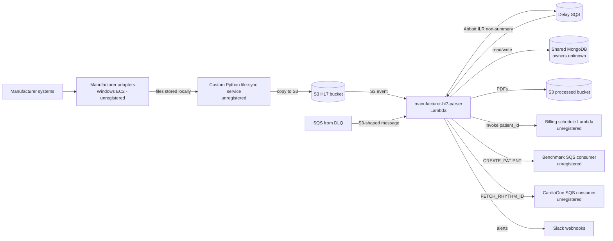
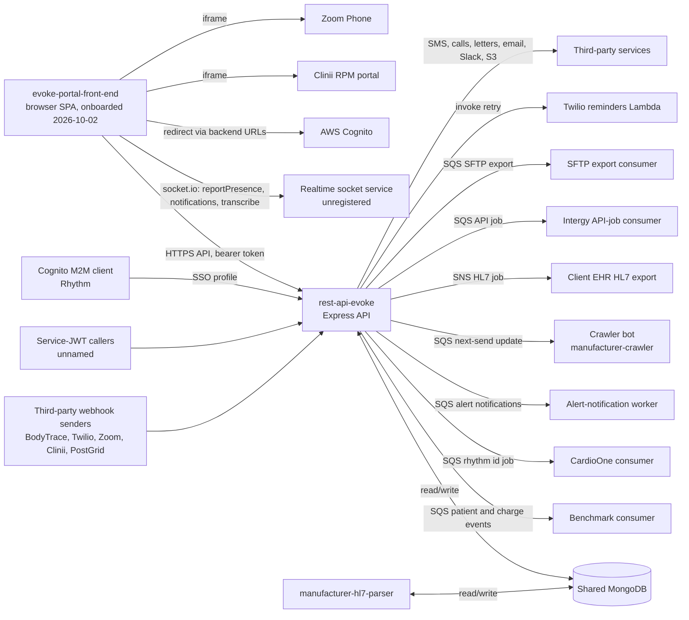

# System Overview

Provenance: assembled at onboarding of `manufacturer-hl7-parser` (analyzed commit e185ff36fe03c649cd7e9750e895c8c43f857c43, 2026-10-01, aisdlc@1.0.0) and extended on 2026-10-02 with `rest-api-evoke` (analyzed commit 4178ce47396c524dfd22a4dd107927b3b28eb100, 2026-10-01T17:57:10Z, aisdlc@1.0.0). Edges are those in `system/repository-relationships.yaml`; status per edge is shown. Two repositories are onboarded; everything else is unregistered. Per-repository detail lives in `repositories/<repo>/architecture.md` and is not repeated here.

## Confirmed picture: ingestion (manufacturer-hl7-parser)

| Edge | Kind | Status |
|---|---|---|
| Adapters -> file-sync service | file | human-confirmed |
| File-sync service -> pipeline (S3 event / SQS from DLQ) | event | human-confirmed |
| Pipeline -> billing schedule Lambda | api | human-confirmed |
| Pipeline -> Benchmark SQS consumer | event | human-confirmed |
| Pipeline -> CardioOne SQS consumer | event | human-confirmed |
| Pipeline <-> shared MongoDB | database | human-confirmed (shared, owned elsewhere; owners unnamed) |
| Pipeline -> Slack | third-party | observed |

## Confirmed picture: portal back end (rest-api-evoke)

| Edge | Kind | Status |
|---|---|---|
| Portal front end -> rest-api-evoke | api | human-confirmed (portal registered; uses both unversioned and /v2 routes) |
| Portal front end -> realtime socket service | event (websocket) | human-confirmed (separate service; repository not named) |
| Portal front end -> AWS Cognito, Clinii, Zoom Phone | third-party | human-confirmed |
| Portal front end -> manufacturer-hl7-parser | indirect data link via rest-api-evoke and the shared MongoDB | human-confirmed |
| Portal front end -> Benchmark web app | outbound link | observed |
| Third-party webhook senders -> rest-api-evoke | third-party | human-confirmed |
| Service-JWT callers -> rest-api-evoke | api | human-confirmed (callers unnamed) |
| Cognito M2M (Rhythm) -> rest-api-evoke | api | human-confirmed |
| rest-api-evoke <-> manufacturer-hl7-parser (shared MongoDB) | database | human-confirmed |
| manufacturer-hl7-parser -> rest-api-evoke (parser-written reports and PDF paths read by the API) | file | inferred |
| rest-api-evoke -> Benchmark consumer | event | human-confirmed |
| rest-api-evoke -> CardioOne consumer | event | human-confirmed |
| rest-api-evoke -> alert-notification worker | event | human-confirmed |
| rest-api-evoke -> crawler bot (manufacturer-crawler) | event | human-confirmed |
| rest-api-evoke -> client EHR HL7 export | event | human-confirmed |
| rest-api-evoke -> Intergy API-job consumer | event | human-confirmed |
| rest-api-evoke -> SFTP export consumer | event | human-confirmed |
| rest-api-evoke -> Twilio reminders Lambda | api | human-confirmed |
| rest-api-evoke -> third-party services | third-party | observed |

Unregistered endpoints in these edges (source or target not onboarded) are flagged `source_registered: false` or `target_registered: false` in `system/repository-relationships.yaml`; the repository ids for the consumers are descriptive.

## Data ownership

- Shared MongoDB: developer-confirmed that `rest-api-evoke` owns the application and configuration data (accounts, users, hospitals, alert configurations, report templates, HL7 and SFTP jobs, billing and RPM, outreach data). `patients`, `reports`, `report_notes`, `tasks`, `sequencers` and `cardio_one_api_logs` are shared between `rest-api-evoke` and `manufacturer-hl7-parser` with no single owner. The parser writes `patients`, `reports`, `report_notes`, `alert_metadata`, `patient_analytics`, `sequencers`, `devices`, `leads`, `tasks`, `live_call_tasks` (delete only), `cardio_one_api_logs`, `delayed_messages`, `user_activity_logs`; it only reads `accounts`, `manufacturers`, `device_types`, `users`, `device_group`, `report_templates`, `report_note_sections`, `report_note_alert_protocols`. Owners of any other collection: unknown.
- S3 processed bucket: PDFs written by the pipeline; readers unknown (the API reads report file paths written by the pipeline, status inferred).
- Report data is created by the pipeline (or by manual upload and intake in the API) and then edited by staff through the API.

## Path of each capability

| Capability | Path across repositories |
|---|---|
| Device Transmission Report Ingestion | adapters -> file-sync -> S3 -> manufacturer-hl7-parser -> MongoDB + processed S3; manual upload, in-office files, BodyTrace and Clinii -> rest-api-evoke -> MongoDB |
| Automated Report Notes and Alerts | manufacturer-hl7-parser (reads note configuration from MongoDB) -> MongoDB; portal -> rest-api-evoke (alert configuration, protocols, dispatch) -> alert-notification worker |
| Billing Code and Schedule Assignment | manufacturer-hl7-parser -> MongoDB, billing schedule Lambda, Benchmark queue; portal -> rest-api-evoke (billing validation, RPM, invoices) -> Benchmark and CardioOne consumers |
| Patient and Device Registration | manufacturer-hl7-parser -> MongoDB, CardioOne queue; portal -> rest-api-evoke (enrolment, management) -> MongoDB, Benchmark, CardioOne, crawler bot |
| Report Review, Notes and Assignment | portal -> rest-api-evoke -> MongoDB (+ alert-notification worker, EHR export consumers on processing) |
| EHR Export: HL7, SFTP and API Jobs | portal or processing event -> rest-api-evoke -> MongoDB + SNS (client EHR HL7 export), SQS (Intergy, SFTP export consumers) |
| Patient Outreach | portal -> rest-api-evoke -> Twilio reminders Lambda, PostGrid, SES; Twilio and Zoom webhooks -> rest-api-evoke -> MongoDB |
| Access and Account Administration | portal -> rest-api-evoke (login, MFA, Cognito SSO, admin, dashboard) -> MongoDB; Rhythm Cognito client -> rest-api-evoke |
| Patient Management and RPM | portal -> rest-api-evoke -> MongoDB (patients created by manufacturer-hl7-parser); portal -> Clinii iframe (URL from rest-api-evoke) |
| Task Management | portal -> rest-api-evoke -> MongoDB; notifications via the realtime socket service |
| Billing Management | portal -> rest-api-evoke -> MongoDB, Benchmark events; outbound link to the Benchmark web app |
| Administration and Configuration | portal -> rest-api-evoke -> MongoDB |
| Dashboard and Notifications | portal -> rest-api-evoke (analytics, notifications) and realtime socket service (presence, notification refresh) |
| Patient Communication | portal -> Zoom Phone iframe; portal -> rest-api-evoke (communication logs, letters, live calls); dictation via the realtime socket service |

Repository architecture: [manufacturer-hl7-parser](../../repositories/manufacturer-hl7-parser/architecture.md), [rest-api-evoke](../../repositories/rest-api-evoke/architecture.md).

## Open questions

- Owners of the shared MongoDB collections other than those named above and whether any application beyond the portal presents reports to staff.
- The repository that serves the portal's realtime socket namespaces, the Clinii host and the purpose of the `evoke.lcwms.co` embed allowed in the portal's CSP are unknown. The portal owns no persistent data (human-confirmed 2026-10-02) and has no direct call to the parser; deployment goes through the `eks-yml-manifest` repository (not recorded as an edge at the developer's request). Per-repository detail: [evoke-portal-front-end](../../repositories/evoke-portal-front-end/architecture.md).
- Consumers of the processed-bucket PDFs.
- Inactive path: `src/artanis/` would call an Artanis AI Lambda but has no caller and no configured target; not shown as an edge.
- Callers of the service-JWT endpoints are unnamed; repository names of the unregistered consumers (Benchmark, CardioOne, alert notification, crawler, client EHR HL7 export, Intergy, SFTP export, Twilio reminders Lambda) are descriptive ids.
- Whether the CardioOne consumer accepts both event spellings used by the two repositories is unknown.
- Whether the portal still calls the legacy v1 endpoints that remain mounted is unknown.
