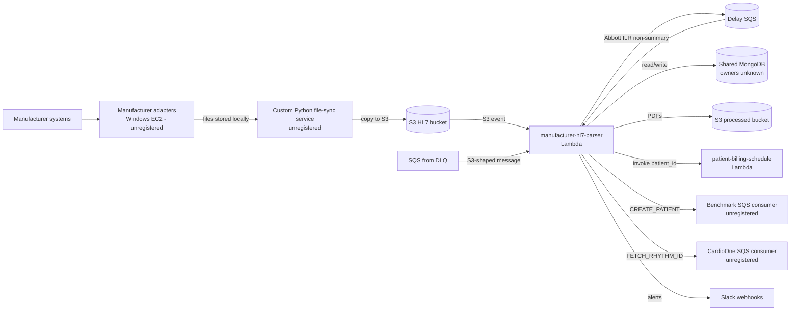
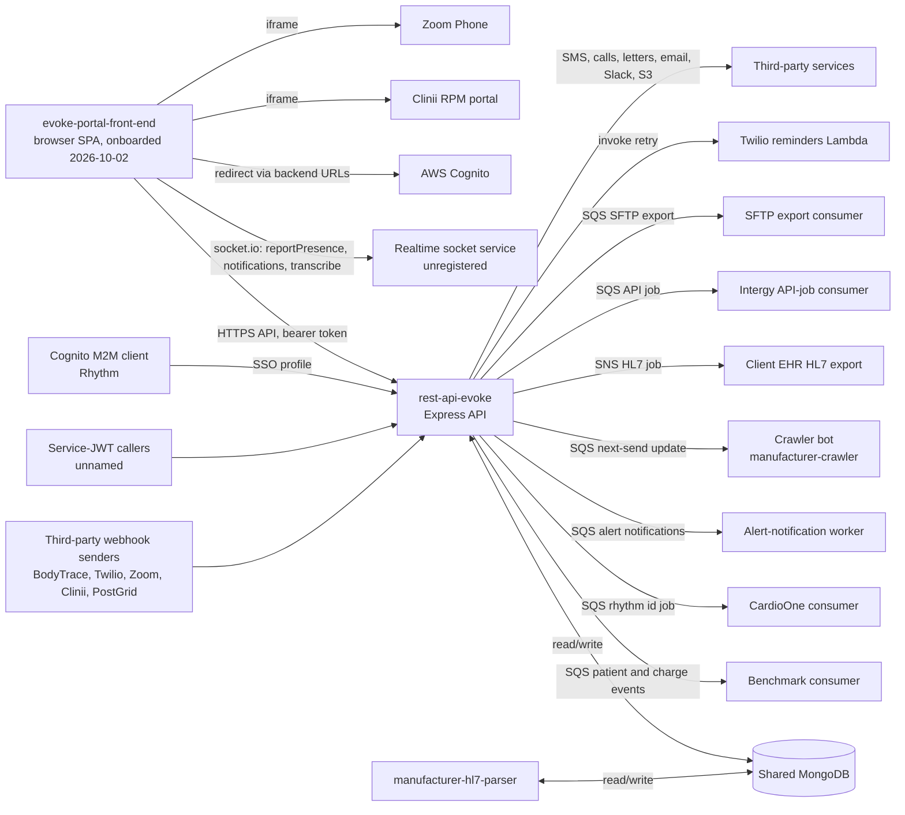
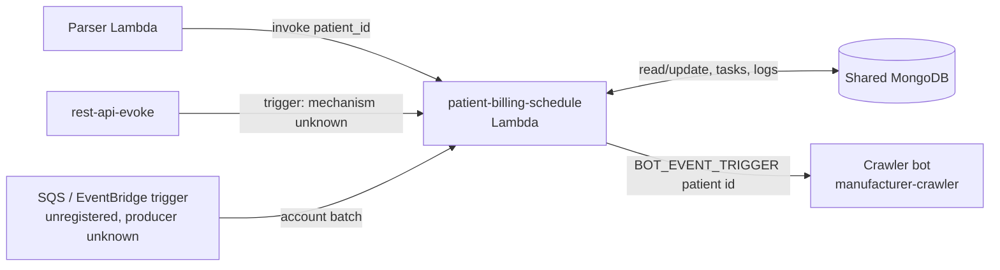
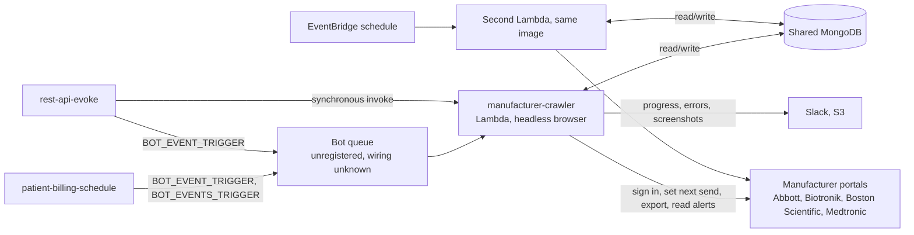
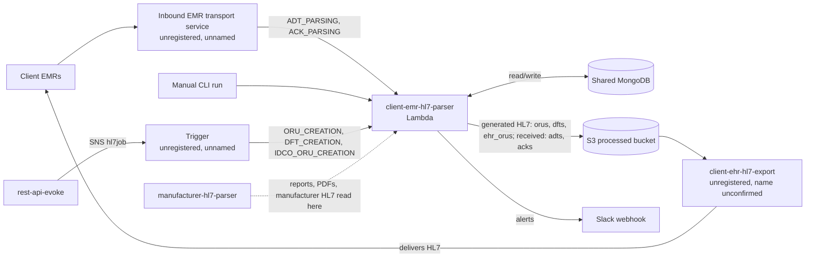

# System Overview

Provenance: assembled at onboarding of `manufacturer-hl7-parser` (analyzed commit e185ff36fe03c649cd7e9750e895c8c43f857c43, 2026-10-01, aisdlc@1.0.0) extended on 2026-10-05 with `patient-billing-schedule` (analyzed commit ec1d8894c633996d7fc9e7a9423d21521a981bf6, aisdlc@1.0.0) and on 2026-10-02 with `rest-api-evoke` (analyzed commit 4178ce47396c524dfd22a4dd107927b3b28eb100, 2026-10-01T17:57:10Z, aisdlc@1.0.0). Edges are those in `system/repository-relationships.yaml`; status per edge is shown. Extended on 2026-10-15 with `manufacturer-crawler` (analyzed commit d6aa388a03c12e777846a704818ba5903a021a4f, aisdlc@1.0.0). Repositories onboarded include the parser, the portal back end, the portal front end, patient-billing-schedule, client-emr-hl7-parser and manufacturer-crawler; everything else is unregistered. Per-repository detail lives in `repositories/<repo>/architecture.md` and is not repeated here.

## Confirmed picture: ingestion (manufacturer-hl7-parser)

| Edge | Kind | Status |
|---|---|---|
| Adapters -> file-sync service | file | human-confirmed |
| File-sync service -> pipeline (S3 event / SQS from DLQ) | event | human-confirmed |
| Pipeline -> patient-billing-schedule | api | human-confirmed |
| Pipeline -> Benchmark SQS consumer | event | human-confirmed |
| Pipeline -> CardioOne SQS consumer | event | human-confirmed |
| Pipeline <-> shared MongoDB | database | human-confirmed (shared, owned elsewhere; owners unnamed) |
| Pipeline -> Slack | third-party | observed |

## Confirmed picture: portal back end (rest-api-evoke)

| Edge | Kind | Status |
|---|---|---|
| Portal front end -> rest-api-evoke | api | human-confirmed (portal registered; uses both unversioned and /v2 routes) |
| Portal front end -> realtime socket service | event (websocket) | human-confirmed (separate service; repository not named) |
| Portal front end -> AWS Cognito, Clinii, Zoom Phone | third-party | human-confirmed |
| Portal front end -> manufacturer-hl7-parser | indirect data link via rest-api-evoke and the shared MongoDB | human-confirmed |
| Portal front end -> Benchmark web app | outbound link | observed |
| Third-party webhook senders -> rest-api-evoke | third-party | human-confirmed |
| Service-JWT callers -> rest-api-evoke | api | human-confirmed (callers unnamed) |
| Cognito M2M (Rhythm) -> rest-api-evoke | api | human-confirmed |
| rest-api-evoke <-> manufacturer-hl7-parser (shared MongoDB) | database | human-confirmed |
| manufacturer-hl7-parser -> rest-api-evoke (parser-written reports and PDF paths read by the API) | file | inferred |
| rest-api-evoke -> Benchmark consumer | event | human-confirmed |
| rest-api-evoke -> CardioOne consumer | event | human-confirmed |
| rest-api-evoke -> alert-notification worker | event | human-confirmed |
| rest-api-evoke -> crawler bot (manufacturer-crawler) | event | human-confirmed |
| rest-api-evoke -> client EHR HL7 export | event | human-confirmed |
| rest-api-evoke -> Intergy API-job consumer | event | human-confirmed |
| rest-api-evoke -> SFTP export consumer | event | human-confirmed |
| rest-api-evoke -> Twilio reminders Lambda | api | human-confirmed |
| rest-api-evoke -> third-party services | third-party | observed |

Unregistered endpoints in these edges (source or target not onboarded) are flagged `source_registered: false` or `target_registered: false` in `system/repository-relationships.yaml`; the repository ids for the consumers are descriptive.

## Confirmed picture: billing scheduler (patient-billing-schedule)

| Edge | Kind | Status |
|---|---|---|
| Parser -> patient-billing-schedule | api | human-confirmed |
| rest-api-evoke -> patient-billing-schedule | api | human-confirmed (mechanism unknown) |
| SQS / EventBridge trigger -> patient-billing-schedule | event | human-confirmed (queue, rule and producer unknown) |
| patient-billing-schedule -> crawler bot (manufacturer-crawler) | event | human-confirmed (consumer repository name unconfirmed) |
| patient-billing-schedule <-> shared MongoDB | database | inferred (schema owner unconfirmed) |

Per-repository detail: [patient-billing-schedule](../../repositories/patient-billing-schedule/architecture.md).

## Confirmed picture: portal bot (manufacturer-crawler)

Provenance: added 2026-10-15 for `manufacturer-crawler` (analyzed commit d6aa388a03c12e777846a704818ba5903a021a4f, 2026-10-15T08:55:00Z, aisdlc@1.0.0). Back-end portal bot with no end users (developer-confirmed). One container image is deployed to two Lambdas.

| Edge | Kind | Status |
|---|---|---|
| patient-billing-schedule -> bot queue -> manufacturer-crawler | event | human-confirmed (queue unknown) |
| rest-api-evoke -> bot queue -> manufacturer-crawler | event | human-confirmed (queue unknown) |
| rest-api-evoke -> manufacturer-crawler (synchronous invoke) | api | human-confirmed (disconnected monitors, technical knowledge only) |
| EventBridge schedule -> second Lambda from the same image | event | human-confirmed (rule and cadence unknown) |
| manufacturer-crawler <-> shared MongoDB | database | human-confirmed (ownership under Data ownership) |
| manufacturer-crawler -> manufacturer portals | third-party (browser) | observed |

Path of the next-send update: patient-billing-schedule (late patients whose next send was reached) or rest-api-evoke (staff edit of next send) -> bot queue -> manufacturer-crawler reads the patient and the account from MongoDB -> signs in to the manufacturer portal -> reads the portal's next send and sets the one derived from Evoke's record -> records before and after in `manufacturer_crawler_report_status`. The crawler does not write `patients`.

Per-repository detail: [manufacturer-crawler](../../repositories/manufacturer-crawler/architecture.md). Product: [Manufacturer Portal Next Send Updates](../product/capabilities/manufacturer-portal-next-send-updates.md), [Manufacturer Portal Account Health](../product/capabilities/manufacturer-portal-account-health.md).

## Confirmed picture: client EMR integration (client-emr-hl7-parser)

Provenance: added 2026-10-09 for `client-emr-hl7-parser` (analyzed commit b9615126ee17c4e2583e08ac81faaa9d12c63005, aisdlc@1.0.0). Back-end Lambda with no end users (developer-confirmed).

| Edge | Kind | Status |
|---|---|---|
| Inbound EMR transport service -> client-emr-hl7-parser | event | human-confirmed (service unnamed) |
| Manual CLI run -> client-emr-hl7-parser | cli | human-confirmed |
| rest-api-evoke -> (SNS-fed trigger) -> client-emr-hl7-parser | event, indirect | human-confirmed (trigger unnamed; not client-ehr-hl7-export) |
| client-emr-hl7-parser -> client-ehr-hl7-export (S3 files) | file | human-confirmed (repository name unconfirmed) |
| client-emr-hl7-parser <-> shared MongoDB | database | inferred (ownership below) |
| manufacturer-hl7-parser -> client-emr-hl7-parser (reports, PDFs, manufacturer HL7) | file, indirect | observed |

Per-repository detail: [client-emr-hl7-parser](../../repositories/client-emr-hl7-parser/architecture.md).

## Data ownership

- Shared MongoDB: developer-confirmed that `rest-api-evoke` owns the application and configuration data (accounts, users, hospitals, alert configurations, report templates, HL7 and SFTP jobs, billing and RPM, outreach data). `patients`, `reports`, `report_notes`, `tasks`, `sequencers` and `cardio_one_api_logs` are shared between `rest-api-evoke` and `manufacturer-hl7-parser` with no single owner. The parser writes `patients`, `reports`, `report_notes`, `alert_metadata`, `patient_analytics`, `sequencers`, `devices`, `leads`, `tasks`, `live_call_tasks` (delete only), `cardio_one_api_logs`, `delayed_messages`, `user_activity_logs`; it only reads `accounts`, `manufacturers`, `device_types`, `users`, `device_group`, `report_templates`, `report_note_sections`, `report_note_alert_protocols`. Owners of any other collection: unknown.
- patient-billing-schedule: human-confirmed owner of the collections `billing_activity_logger` and `manufacturer_crawler_report_status`. In the shared database it updates (never inserts) `patients` and `reports`, inserts and archives `tasks`, upserts `user_activity_logs`, and reads `accounts`, `users`, `devices` and `device_types`; the schema owner of the shared collections is not confirmed (inferred from code).
- client-emr-hl7-parser: human-confirmed owner of `adts`, `adts_book_keeping` and `acks`. It reads `reports`, `report_cover_pages`, `hl7jobs`, `report_notes`, `accounts`, `users`, `devices`, `manufacturers`, reads and writes `patients`, `patient_diagnoses` and `sequencers`, and inserts `tasks`; the schema owner of those shared collections is unconfirmed. Its S3 prefixes `orus/`, `dfts/`, `ehr_orus/`, `adts/` and `acks/` are written by this repository.
- manufacturer-crawler (developer-confirmed 2026-10-15): owns `manufacturer_crawler_report_status`, `manufacturer_crawler_account_status`, `biotronik_exported_reports` and `noshow_disconnected_logs`. It shares `manufacturer_accounts` (owned by `rest-api-evoke`; the bot sets accounts inactive) and `reports` (created by `manufacturer-hl7-parser`; the bot adds `transmission_alert_information`), and only reads `patients`. This conflicts with the patient-billing-schedule bullet above, which names patient-billing-schedule as owner of `manufacturer_crawler_report_status`; both repositories write that collection (see Open questions).
- S3 processed bucket: PDFs written by the pipeline; readers unknown (the API reads report file paths written by the pipeline, status inferred).
- Report data is created by the pipeline (or by manual upload and intake in the API) and then edited by staff through the API.

## Path of each capability

| Capability | Path across repositories |
|---|---|
| Device Transmission Report Ingestion | adapters -> file-sync -> S3 -> manufacturer-hl7-parser -> MongoDB + processed S3; manual upload, in-office files, BodyTrace and Clinii -> rest-api-evoke -> MongoDB; EventBridge schedule -> manufacturer-crawler -> manufacturer portal (Medtronic, Abbott alert capture; Biotronik export) -> MongoDB `reports` / `biotronik_exported_reports` |
| Manufacturer Portal Next Send Updates (internal, proposed) | patient-billing-schedule or rest-api-evoke -> bot queue -> manufacturer-crawler -> manufacturer portal; outcome -> MongoDB `manufacturer_crawler_report_status` |
| Manufacturer Portal Account Health (internal, proposed) | manufacturer-crawler -> manufacturer portal (login error) -> MongoDB `manufacturer_accounts` (inactive) and `manufacturer_crawler_account_status`; Slack notice |
| Automated Report Notes and Alerts | manufacturer-hl7-parser (reads note configuration from MongoDB) -> MongoDB; portal -> rest-api-evoke (alert configuration, protocols, dispatch) -> alert-notification worker |
| Billing Code and Schedule Assignment | manufacturer-hl7-parser -> MongoDB, patient-billing-schedule, Benchmark queue; portal -> rest-api-evoke (billing validation, RPM, invoices) -> Benchmark and CardioOne consumers |
| Billing Window Scheduling | parser (after a report is stored), rest-api-evoke (mechanism unknown) or an SQS / EventBridge account batch -> patient-billing-schedule -> MongoDB (billable report, billing dates, next send, late date, tasks, inactivation) -> crawler bot queue for late patients |
| Patient and Device Registration | client EMR -> inbound EMR transport service -> client-emr-hl7-parser (ADT, ORM, ORU) -> MongoDB (patients, adts, NEW PATIENT task) + S3, acknowledgement back via the transport service; manufacturer-hl7-parser -> MongoDB, CardioOne queue; patient-billing-schedule -> MongoDB (730-day inactivation); portal -> rest-api-evoke (enrolment, management) -> MongoDB, Benchmark, CardioOne, crawler bot |
| Report Review, Notes and Assignment | portal -> rest-api-evoke -> MongoDB (+ alert-notification worker, EHR export consumers on processing) |
| EHR Export: HL7, SFTP and API Jobs | portal or processing event -> rest-api-evoke -> MongoDB + SNS (hl7job topic) -> unnamed trigger -> client-emr-hl7-parser (builds ORU, DFT, IDCO ORU; reads MongoDB and S3) -> S3 -> client-ehr-hl7-export -> client EMR; SQS (Intergy, SFTP export consumers) |
| EHR Delivery Acknowledgements (internal) | client EMR -> inbound EMR transport service -> client-emr-hl7-parser -> S3 `acks/` + MongoDB `acks` |
| Patient Outreach | portal -> rest-api-evoke -> Twilio reminders Lambda, PostGrid, SES; Twilio and Zoom webhooks -> rest-api-evoke -> MongoDB |
| Access and Account Administration | portal -> rest-api-evoke (login, MFA, Cognito SSO, admin, dashboard) -> MongoDB; Rhythm Cognito client -> rest-api-evoke |
| Patient Management and RPM | portal -> rest-api-evoke -> MongoDB (patients created by manufacturer-hl7-parser; late-patient follow-up tasks created by patient-billing-schedule); portal -> Clinii iframe (URL from rest-api-evoke) |
| Task Management | portal -> rest-api-evoke -> MongoDB; notifications via the realtime socket service |
| Billing Management | portal -> rest-api-evoke -> MongoDB, Benchmark events; outbound link to the Benchmark web app |
| Administration and Configuration | portal -> rest-api-evoke -> MongoDB |
| Dashboard and Notifications | portal -> rest-api-evoke (analytics, notifications) and realtime socket service (presence, notification refresh) |
| Patient Communication | portal -> Zoom Phone iframe; portal -> rest-api-evoke (communication logs, letters, live calls); dictation via the realtime socket service |

Repository architecture: [client-emr-hl7-parser](../../repositories/client-emr-hl7-parser/architecture.md), [manufacturer-hl7-parser](../../repositories/manufacturer-hl7-parser/architecture.md), [rest-api-evoke](../../repositories/rest-api-evoke/architecture.md), [patient-billing-schedule](../../repositories/patient-billing-schedule/architecture.md), [manufacturer-crawler](../../repositories/manufacturer-crawler/architecture.md).

## Open questions

- Owners of the shared MongoDB collections other than those named above and whether any application beyond the portal presents reports to staff.
- The repository that serves the portal's realtime socket namespaces, the Clinii host and the purpose of the `evoke.lcwms.co` embed allowed in the portal's CSP are unknown. The portal owns no persistent data (human-confirmed 2026-10-02) and has no direct call to the parser; deployment goes through the `eks-yml-manifest` repository (not recorded as an edge at the developer's request). Per-repository detail: [evoke-portal-front-end](../../repositories/evoke-portal-front-end/architecture.md).
- Consumers of the processed-bucket PDFs.
- Inactive path: `src/artanis/` would call an Artanis AI Lambda but has no caller and no configured target; not shown as an edge.
- Callers of the service-JWT endpoints are unnamed; repository names of the unregistered consumers (Benchmark, CardioOne, alert notification, crawler, client EHR HL7 export, Intergy, SFTP export, Twilio reminders Lambda) are descriptive ids.
- Whether the CardioOne consumer accepts both event spellings used by the two repositories is unknown.
- Whether the portal still calls the legacy v1 endpoints that remain mounted is unknown.
- client-emr-hl7-parser: identity and repository of the inbound EMR transport service and of the trigger that turns the hl7job topic into creation events; whether `client-ehr-hl7-export` is the real repository name of the delivery service; schema owners of the shared collections it touches. Note: earlier text in this document names client-ehr-hl7-export as the consumer of the rest-api-evoke SNS job; per the developer (2026-10-09) the topic feeds an unnamed trigger that invokes client-emr-hl7-parser, and client-ehr-hl7-export delivers its S3 output.
- manufacturer-crawler: queue names, event source mapping and whether the two senders share one bot queue; the EventBridge schedule and cadence; Lambda timeout, memory and concurrency; which collection owner is correct for `manufacturer_crawler_report_status` (crawler per the developer 2026-10-15, patient-billing-schedule per the earlier confirmation; both write it); whether anything updates `patients.next_send` after the portal changes; the glossary "Bot event" definition differs from the crawler's behavior. Disconnected monitors are excluded from product documentation by the developer.
- patient-billing-schedule: the queue, EventBridge rule and producer for account batches, how rest-api-evoke triggers it, the schema owner of the shared collections it updates, and the repository name of the crawler bot consumer are unknown.
